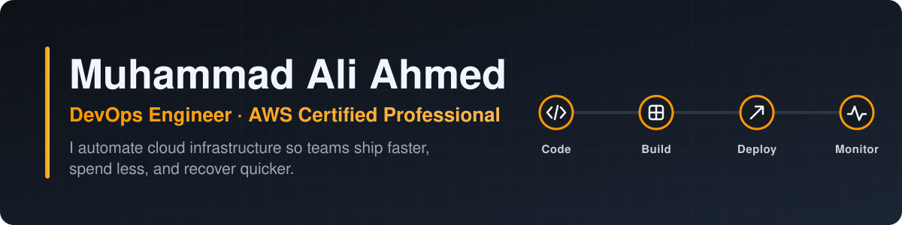
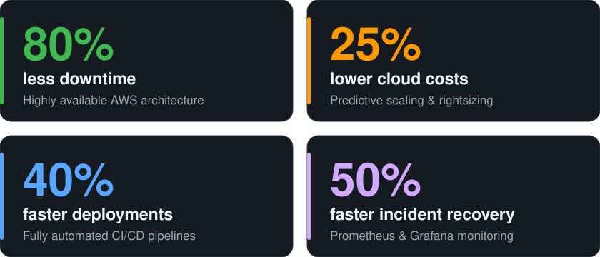

  

  
  

  
  
  
  
  

## 👋 About me

I'm a DevOps engineer who builds and runs cloud infrastructure on AWS. In plain terms, I make sure that:

- **apps stay online**, even when traffic spikes or a server fails
- **releases ship safely and automatically**, without late-night manual deployments
- **the cloud bill stays lean**, because you only pay for what you actually use
- **problems are spotted and fixed fast**, before users notice

## 📈 Impact at a glance

  

Beyond the numbers:

- 🛡️ Led cloud hardening programs that passed **internal and external security audits**
- ⚙️ Wrote automation scripts that cut environment setup by **~5 hours** across HRMS & CRM projects

## 🧰 What I work with

| Area | What I do | Tools |
|---|---|---|
| ☁️ **Cloud** | Design scalable, highly available infrastructure |  |
| 🏗️ **Infrastructure as Code** | Define servers and networks in code so environments are repeatable |  |
| 📦 **Containers** | Package and orchestrate apps to run the same everywhere |  |
| 🔁 **CI/CD** | Automate testing and zero-downtime deployments |   |
| 📈 **Observability** | Metrics, dashboards, logs and alerts for fast incident response |   |
| 🐧 **Linux** | Administer and harden production servers |  |

## 🔨 Featured project

### 🛡️ [AWS GuardDuty Threat Detection Lab](https://github.com/m-aliahmed/aws-guardduty-threat-remediation)

A hands-on DevSecOps lab: deploy a deliberately vulnerable web app, attack it, and watch AWS catch the attack.

1. **Deploy:** one CloudFormation template stands up OWASP Juice Shop on EC2, along with S3, VPC and CloudFront.
2. **Attack:** SQL injection bypasses the login, then command injection steals the server's AWS credentials.
3. **Detect:** GuardDuty flags the stolen credentials being used and raises security findings.

`CloudFormation` `EC2` `S3` `VPC` `CloudFront` `GuardDuty` `OWASP Juice Shop`

## 📫 Let's connect

💬 Ask me about **Terraform, Ansible, container orchestration, or disaster recovery**. I'm always happy to talk shop.
Reach me at **[m.aliahmed0101@gmail.com](mailto:m.aliahmed0101@gmail.com)**, on [LinkedIn](https://www.linkedin.com/in/muhammad-ali-ahmed-devops), or through my website **[aliahmed-devops.vercel.app](https://aliahmed-devops.vercel.app/)**.

<i>Happy DevOps! 🚀</i>

